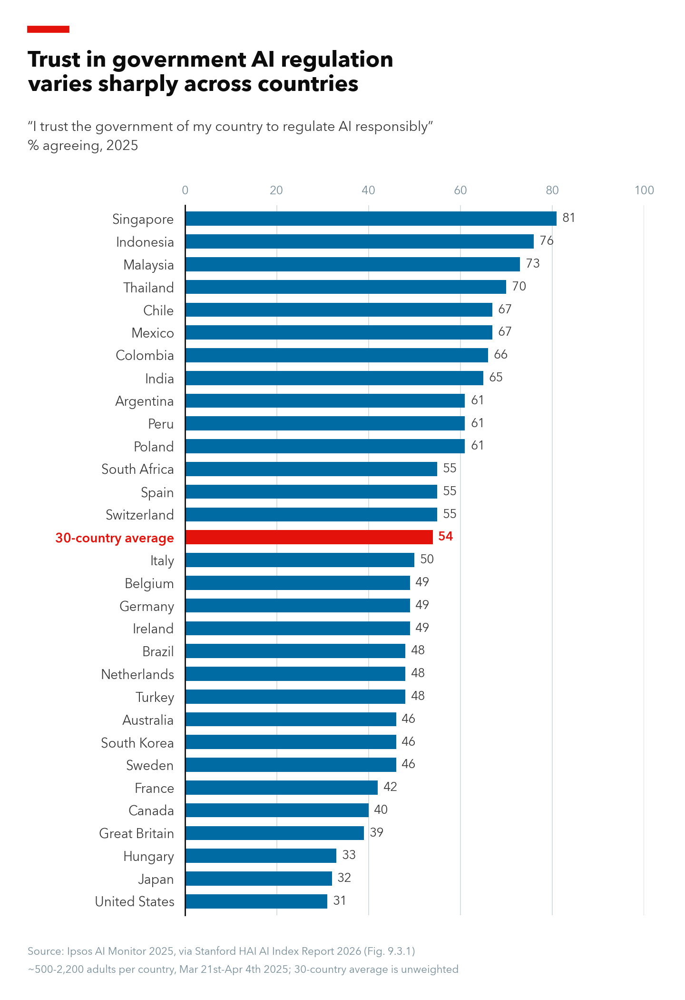
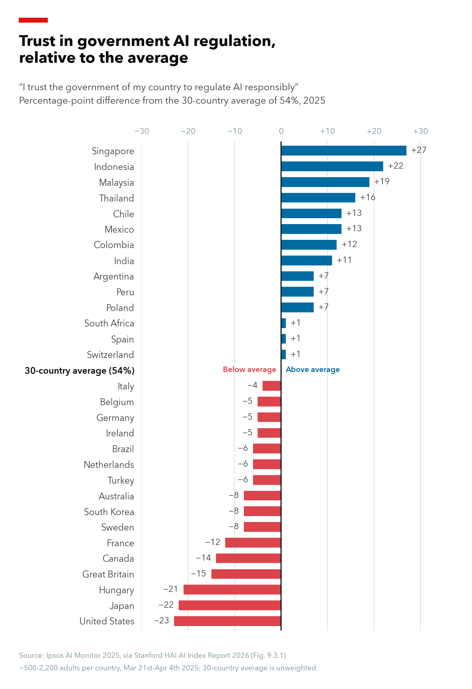

# Trust in government regulation of AI, 2025

A reproduction of **Figure 9.3.1, "Trust in government regulation of AI by country, 2025"**,
from Stanford HAI's [AI Index Report 2026](https://hai.stanford.edu/ai-index/2026-ai-index-report)
(Chapter 9, Public Opinion), plus a second figure showing each country's distance from the
30-country average.

| Original figure | Deviation from average |
|---|---|
|  |  |

## Data

- **Survey:** [Ipsos AI Monitor 2025](https://www.ipsos.com/sites/default/files/ct/news/documents/2025-06/Ipsos-AI-Monitor-2025_0.pdf),
  30 countries, 23,216 adults, fielded March 21 – April 4, 2025.
- **Question:** "I trust the government of [country] to regulate AI responsibly." Values are the
  % who agree.
- **File used:** Stanford's original CSV for the figure, `9. Public Opinion/Data/fig_9.3.1.csv`,
  from the AI Index [public data folder](https://drive.google.com/drive/folders/1zJTOg0iR0j5SijCwFutwWvDt143lW277).
  `get_data.py` downloads it to `data/raw/fig_9.3.1.csv`. No values are typed in by hand.
- The Ipsos AI Monitor 2026 does not report this question, so the data stop at 2025.

## How to reproduce

Requires Python 3.9+. From the repository folder:

```bash
python3 -m venv .venv
.venv/bin/pip install -r requirements.txt
.venv/bin/python get_data.py    # download Stanford's CSV -> data/raw/fig_9.3.1.csv
.venv/bin/python plot.py        # original figure -> figures/trust_gov_regulate_ai_2025.png and .pdf
.venv/bin/python plot_diff.py   # deviation figure -> figures/trust_gov_regulate_ai_2025_diff_from_avg.png
```

- `plot.py` ranks the countries and highlights the 30-country average in red.
- `plot_diff.py` keeps the same order and plots each country minus the average (54%), taken from
  the CSV's "Global" row. Blue bars are above average, red bars below.
- Both use Avenir Next if installed (macOS), then Helvetica Neue or Inter, otherwise matplotlib's
  default font. The figures look slightly different on other systems; the data do not.

## Optional extension: deviation from the average

The second figure (`plot_diff.py`) shows each country's percentage-point difference from the
unweighted 30-country average of 54%, calculated directly from the CSV, with countries in the same
order as the original. Centering on the average makes it easier to see that more countries fall
below it (16) than above it (14), and that the United States (−23), Japan (−22) and Hungary (−21)
sit about as far below the average as Indonesia (+22) sits above it.

## Validation checks

1. **Against Stanford's figure:** all 31 plotted values (30 countries + average) match Figure 9.3.1
   in the report and in Stanford's chart file. Largest difference: 0 points.
2. **Against Ipsos:** all 31 values match the table on p. 23 of the Ipsos report (e.g. United States
   31%, India 65%, Singapore 81%, average 54%). We found no public respondent-level data, so
   this is a check against Ipsos's published report only.
3. **Against Pew (different question):** Pew's Spring 2025 survey asked how much people trust their
   *country* to regulate AI *effectively*. Across the 21 countries in both surveys the broad pattern
   is similar (high in Indonesia, low in the US and Japan), but many countries differ by 10–28
   points (US 31% Ipsos vs 44% Pew; India 65% vs 89%) and the values correlate only weakly
   (r = 0.32). Wording, answer scale, survey mode and samples all differ, so the gaps can't be
   pinned on one cause.

## Limitations

- **Weighting:** Ipsos weights each country to census demographics; the CSV already contains the
  weighted results, so no weights are applied here.
- **The 54% average is unweighted:** every country counts equally regardless of population. It is
  not a world figure, and "above/below average" only means relative to these 30 countries.
- **Unequal samples:** Ipsos says its samples in Brazil, Chile, Colombia, Indonesia, Ireland,
  Malaysia, Mexico, Peru, Singapore, South Africa, Thailand and Türkiye are more urban, educated or
  affluent than the population; India's sample is urban and mostly interviewed face to face. Several
  high-trust countries are in this group.
- **Small differences are noise:** Ipsos reports credibility intervals of ±3.5 points for samples
  of ~1,000 and ±5.0 for ~500. Gaps of a few points (e.g. US 31%, Japan 32%, Hungary 33%) should not
  be read as a ranking.
- **Description, not explanation:** the data show where trust is high or low, not why.
- **Naming:** Stanford's CSV says "Turkey" where Ipsos says "Türkiye".

## Files

| File | Purpose |
|---|---|
| `get_data.py` | Downloads Stanford's CSV and checks it is the expected file |
| `plot.py` | Draws the original ranked bar chart |
| `plot_diff.py` | Draws the deviation-from-average chart |
| `data/raw/fig_9.3.1.csv` | Downloaded data (as used for the figures) |
| `figures/` | Output PNGs and PDF |
